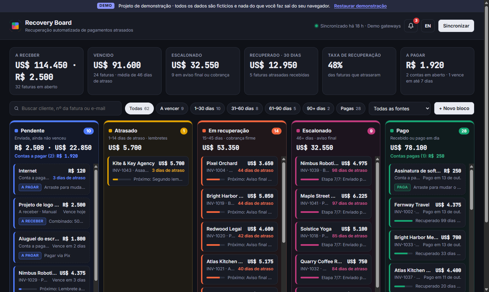

# Recovery Board

**Painel de recuperação de pagamentos atrasados para freelancers.** Projeto de demonstração e portfólio: todos os dados são fictícios, não há login e nada do que o visitante faz sai do navegador dele.

🔗 **Demo ao vivo:** _adicione aqui o link do Render depois de publicar_



> 🇺🇸 **English summary** — A debt-recovery dashboard for freelancers: invoices are sorted into five color-coded workflow zones by how late they are, with search, overdue-timeframe filters, an automated collection timeline with message templates, and drag-and-drop blocks for tracking your own bills, with due-date alerts. Demo project: fictional data, no login, the UI switches between Portuguese and English. Built with Node.js/Express and vanilla JavaScript, developed with an AI coding assistant (Claude Code).

## O que dá para testar

- **5 zonas coloridas do fluxo de cobrança**: Pendente, Atrasado (1–14 dias), Em recuperação (15–45), Escalonado (46+) e Pago. Cada fatura muda de zona sozinha conforme o atraso.
- **Busca por cliente**: mostra em que etapa está cada fatura daquele cliente e quanto ele deve. Os números do topo acompanham a busca e os filtros.
- **Filtro por tempo de atraso**: a vencer, 1–30, 31–60, 61–90, 90+ dias e pagas.
- **Fluxo de cobrança automática**: ao clicar numa fatura, aparecem as 7 etapas (lembrete, cobrança firme, parcelamento, aviso final…) e a **mensagem de cobrança da etapa atual**, gerada a partir de modelos com os dados da fatura.
- **Blocos manuais com arrastar e soltar**: crie suas próprias contas a pagar ou a receber e arraste-as entre as colunas. A etiqueta e o cabeçalho de cada coluna se adaptam à situação.
- **Alertas de cobrança** 🔔: avisam de contas vencidas, que vencem hoje ou nos próximos 3 dias, e sugerem a coluna certa quando um bloco está fora do lugar.
- **Português e inglês**, tema claro e escuro automático, e layout que funciona no celular.
- **Atualização diária automática** dos dados de pagamento, com botão para sincronizar na hora.

## Como funciona

| Parte | O que faz |
|---|---|
| [`server.js`](server.js) | Servidor Express: API do painel, sincronização diária (`node-cron`) e recuperação da sincronização quando o servidor estava desligado |
| [`public/logic.js`](public/logic.js) | Regras de datas, zonas e alertas, **compartilhadas** entre servidor e navegador |
| [`src/status.js`](src/status.js) | Classifica faturas nas zonas e monta o fluxo de cobrança |
| [`src/sources/`](src/sources/) | Integrações: Stripe e Asaas (APIs REST reais, desligadas na demo) e a fonte de demonstração |
| [`public/app.js`](public/app.js) | Interface: quadro, filtros, alertas, arrastar e soltar, blocos salvos no `localStorage` |
| [`public/i18n.js`](public/i18n.js) | Textos em português e inglês |
| [`test/`](test/) | Testes automáticos das regras (`node:test`) |

**Privacidade:** as faturas exibidas são fictícias e geradas no servidor. Os blocos criados pelo visitante ficam apenas no navegador dele (`localStorage`) e nunca são enviados ao servidor.

## Rodar no seu computador

Precisa do [Node.js](https://nodejs.org) 22 ou mais recente.

```bash
npm install
npm start        # http://localhost:3000
npm test         # testes automáticos
```

## Publicar de graça

O arquivo [`render.yaml`](render.yaml) já deixa tudo pronto para o plano gratuito do [Render](https://render.com): crie um *Blueprint* apontando para este repositório. No plano gratuito o site "dorme" após 15 minutos sem visitas e leva cerca de 30–50 segundos para acordar no primeiro acesso.

## Tecnologias

Node.js · Express · node-cron · JavaScript sem framework · HTML/CSS · `node:test` · Render

Desenvolvido com o apoio de um assistente de programação com IA (Claude Code), usado para planejar, escrever, testar no navegador e revisar o código.
